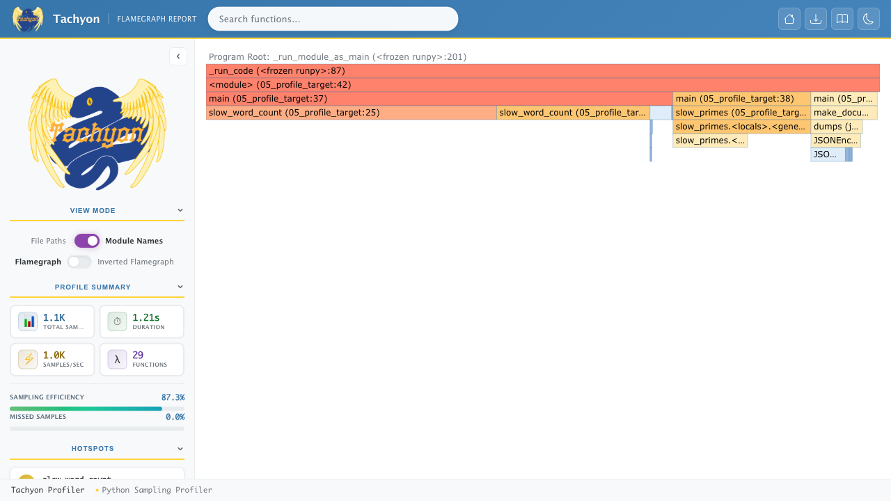

# Python 3.15リリース！

新機能と3.10からの歩み

飛騨高山Pythonの会

---

## 今日の話

1. Python 3.15ってどんなリリース？
2. 3.10→3.15で何が変わった？
3. 3.15の目玉機能（これまでとの比較つき）
4. 開発体験の改善
5. アップグレードの注意点
6. AIと一緒に3.15を使うとき

> デモコードは `demo/2026-10-python315/` にあります。
> 実測の数字は、手元のMacBook（Apple Silicon）で実行した結果です（「公式の数字」と書いたもの、フレームグラフを除く）

---

## 1. Python 3.15ってどんなリリース？

---

### リリース概要

| 項目 | 内容 |
|---|---|
| リリース日 | **2026年10月9日**（予定より1週間延期。rc3を追加） |
| リリースマネージャー | Hugo van Kemenade（リリース作業のまとめ役） |
| バグ修正サポート | 約2年（2028年10月ごろまで） |
| セキュリティサポート | 5年（2031年10月まで） |

新バージョンが出るタイミングは、3.9から毎年10月で変わらない

--

### 3.15の主な新機能

毎日書くコードが**少しずつ楽になる**リリース

| 新機能 | 概要 |
|---|---|
| lazy import | 使うときまでモジュールを読み込まない。起動が速くなる |
| frozendict | 書き換えられない辞書（dict） |
| sentinel | 「値が渡されなかった」を表す専用の目印 |
| 内包表記の `*` | 入れ子のリストを1つのリストにまとめる処理を短く書ける |
| UTF-8がデフォルト | WindowsとMacで、ファイルの読み書きの結果がそろう |
| Tachyon | 動いているプログラムの遅い場所を外から調べる道具 |
| JIT（改良） | よく実行される部分を、実行中に機械語へ変えて速くする仕組み。3.13からあり、3.15で速くなった |

--

### 各バージョンのサポート期限（2026年10月時点）

| バージョン | リリース | サポート終了 | 状態 |
|---|---|---|---|
| **3.15** | 2026年10月 | 2031年10月 | **最新** |
| 3.14 | 2025年10月 | 2030年10月 | バグ修正 |
| 3.13 | 2024年10月 | 2029年10月 | セキュリティのみ |
| 3.12 | 2023年10月 | 2028年10月 | セキュリティのみ |
| 3.11 | 2022年10月 | 2027年10月 | セキュリティのみ |
| ~~3.10~~ | 2021年10月 | **2026年10月** | **サポート終了** |

サポートが終わると、セキュリティの穴が見つかっても修正版が出ない。3.10を使っている人は今がアップグレードのタイミング

---

## 2. 3.10→3.15で何が変わった？

---

### 毎年増えてきた機能

| 機能 | 追加 | 3.10 | 3.11 | 3.12 | 3.13 | 3.14 | 3.15 |
|---|---|---|---|---|---|---|---|
| `except*` / ExceptionGroup | 3.11 | × | ○ | ○ | ○ | ○ | ○ |
| `type` 文・ジェネリクス構文 | 3.12 | × | × | ○ | ○ | ○ | ○ |
| `copy.replace()` | 3.13 | × | × | × | ○ | ○ | ○ |
| t-string | 3.14 | × | × | × | × | ○ | ○ |
| **lazy import** | 3.15 | × | × | × | × | × | ○ |
| **frozendict / sentinel** | 3.15 | × | × | × | × | × | ○ |
| 内包表記の `*` アンパック | 3.15 | × | × | × | × | × | ○ |

○は動いた、×は動かなかった。各バージョンでコード片を実行して判定（`06_compare_versions.py`）

--

### 各バージョンのテーマ

| バージョン | 概要 |
|---|---|
| 3.11 | **速くなった**（Faster CPython）・エラーの場所を詳しく表示 |
| 3.12 | **型ヒントの書き方**が簡単に（`type` 文・`def f[T]()`） |
| 3.13 | 対話モード（REPL）が新しく・**GILなし版**とJITが試験的に登場 |
| 3.14 | **t-string**（安全に文字列を組み立てる）・GILなし版が正式サポート |
| 3.15 | **lazy import**・frozendict・UTF-8・**JITがさらに速く**（まだ試験的） |

GIL：同時に1つのスレッドだけがPythonのコードを実行できるようにする仕組み（4章で詳しく説明）

--

### 速さの比較に使った4つの処理

外部ライブラリを使わない、Pythonだけの処理（`bench_workload.py`）

| 処理 | 何をしているか | 似ている場面 |
|---|---|---|
| 小数の計算 | 3つの天体の動きを、小数の掛け算・割り算で24万回計算する | 数値シミュレーション |
| 整数の計算 | 40万までの数が素数かどうかを、割り算で1つずつ調べる | ループと条件分岐が多い処理 |
| オブジェクト操作 | クラスのインスタンスを240万回作り、メソッドを呼ぶ | クラスを使ったふつうのアプリ |
| 文字列処理 | 文字列を80万回作って大文字に変え、辞書で数える | ログやCSVの集計 |

--

### 速さはどう変わった？

手元のMacで5回ずつ実行（秒・中央値。小さいほど速い）

| バージョン | 小数の計算 | 整数の計算 | オブジェクト操作 | 文字列処理 | 合計 | 3.10比 |
|---|---|---|---|---|---|---|
| 3.10 | 0.674 | 1.156 | 0.684 | 0.198 | 2.712 | 1.00x |
| 3.11 | 0.489 | 0.721 | 0.474 | 0.157 | 1.840 | **1.47x** |
| 3.12 | 0.400 | 0.771 | 0.464 | 0.166 | 1.802 | 1.51x |
| 3.13 | 0.406 | 1.125 | 0.340 | 0.167 | 2.039 | 1.33x |
| 3.14 | 0.429 | 0.706 | 0.354 | 0.177 | 1.666 | 1.63x |
| 3.15 | 0.437 | 0.664 | 0.347 | 0.175 | 1.622 | **1.67x** |
| **3.15 + JIT** | 0.305 | 0.376 | 0.327 | 0.157 | 1.166 | **2.33x** |

--

### 速さの比較結果

- **3.11で一気に1.5倍**。それ以降、インタプリタ単体の速さは少しずつ伸びている
- **3.15でJITを有効にすると、さらに1.4倍**
  - 小数や整数の計算で速くなる。文字列処理はほぼ変わらない
  - JITが何かは、次のページで説明

--

### JITとは？

Pythonのコードは、まず「バイトコード」という命令に変換されてから実行される

```text
s += x * 2   は、5つの命令に分かれる（3.15の dis モジュールで表示）
  LOAD_FAST_BORROW_LOAD_FAST_BORROW (s, x)   # s と x を取り出す
  LOAD_SMALL_INT   2                         # 2 を用意する
  BINARY_OP        (*)                       # 掛け算
  BINARY_OP        (+=)                      # 足し算
  STORE_FAST       s                         # 結果を s にしまう
```

| | ふだん（インタプリタ） | JITを有効にしたとき |
|---|---|---|
| しくみ | 命令を1つずつ読んで、そのつど実行する | 何度も実行される部分を、まとめて機械語に変換して実行する |
| 速さ | ループで同じ命令を何度も読み直すぶん、時間がかかる | 読み直す手間が減るので速くなる |

機械語：CPUがそのまま実行できる命令。JITは「Just-In-Time（実行中に、必要になったときに）」の略

--

### JITで速くなる処理・変わらない処理

**速くなりやすい**

- 小数や整数の計算を何度も繰り返すループ（今回1.4〜1.8倍）

**あまり変わらない**

- 文字列処理・オブジェクト操作（今回約1.1倍）
- 1回しか通らない処理（何度も実行される部分だけが変換されるため）
- ファイルやネットワークの待ち時間
- numpyなど、C言語で書かれた部分（もともと機械語で動く）

```bash
PYTHON_JIT=1 python3.15 my_script.py   # JIT はまだ試験的な扱いで、既定ではオフ
```

公式の数字：Linuxで7〜8%、macOSで11〜12%速い（いろいろな処理の平均。今回は計算の多い処理を測ったので、効果が大きく出た）

---

## 3. 3.15の目玉機能

これまでの書き方と比べて、何がうれしいのか

---

### lazy import（PEP 810）

import：ほかのモジュール（ファイル）の機能を読み込むこと。読み込みには時間がかかる

```python
lazy import json
lazy from pathlib import Path

print("起動しました")       # この時点では json も pathlib も読み込まれていない

data = json.loads("{}")    # ここで初めて json を読み込む
```

- `lazy` を付けたimportは、**最初に使われるまで読み込まれない**
- 使われなければ一度も読み込まれない

--

### lazy import：これまでとの違い

```python
# これまで：起動を速くしたいときは、import を関数の中に移していた
def export_csv(rows):
    import csv              # この関数が呼ばれるまで読み込まない
    ...

# 3.15：import はファイルの先頭にまとめたまま、読み込みだけ遅らせられる
lazy import csv
```

**うれしいこと**

- 使わない機能のぶん、**起動が速くなる**（次のページで実測）
- importを先頭にまとめたままなので、何を使っているか一目で分かる
- 書き換えは `lazy` を足すだけ

--

### lazy importの効果

重いモジュールを8個importするCLIで `--help` だけ実行

```text
Python 3.15.0 / --help の起動時間（中央値・20回）
  import なし   :   18.4 ms
  通常の import :   79.2 ms
  lazy import   :   18.4 ms
  → import 部分 60.8 ms が 0.0 ms に
  読み込まれたモジュール数: 通常 221 / lazy 56
```

`--help` やサブコマンドの多いCLIほど**効果が大きい**

（`01_lazy_imports.py`）

--

### lazy importのルール

- 書けるのは**モジュールの一番外側だけ**
  - 関数・クラスの中、`try` / `except` の中は `SyntaxError`
- `lazy from x import *` は不可
- `lazy` は特定の場所でだけキーワードになる「ソフトキーワード」。`lazy` という変数名は今までどおり使える
- 全体をまとめて切り替えることもできる

```bash
python -X lazy_imports=all app.py        # すべての import を lazy に
```

- 古いバージョンでも動かしたいライブラリ向けの書き方もある

```python
__lazy_modules__ = ["json", "pathlib"]   # 3.15 では lazy、それ以前は通常の import
import json
```

--

### frozendict（PEP 814）

**書き換えられない辞書**（dict）が組み込みに

```python
>>> a = frozendict(x=1, y=2)
>>> a["z"] = 3
TypeError: 'frozendict' object does not support item assignment
>>> a == frozendict(y=2, x=1)       # 順番が違っても中身が同じなら等しい
True
>>> {a: "OK"}                       # 辞書のキーにできる
{frozendict({'x': 1, 'y': 2}): 'OK'}
```

- ハッシュ：値の中身から計算する「整理番号」。辞書は、キーの整理番号を手がかりに値をすばやく探す
- 中身が後から変わると番号も変わって探せなくなるので、書き換えられる `dict` や `list` は辞書のキーにできない
- frozendictは書き換えられないので、整理番号を計算でき、辞書のキーや `set` の要素にできる

--

### frozendict：これまでとの違い

| できること | dict | MappingProxyType<br>（これまでの代わり） | frozendict |
|---|---|---|---|
| 中身を書き換える | できる | 直接はできない | できない |
| 元の辞書の変更が反映される | − | **反映されてしまう** | − |
| 辞書のキーや `set` に入れる | できない | できない | **できる** |
| `@cache`（計算結果を覚える）の引数 | できない | できない | **できる** |

**うれしいこと**

- 設定値などを**うっかり書き換えるバグ**を防げる
- 辞書を、キャッシュのキーや別の辞書のキーとして使える

`MappingProxyType` の列は3.14で実際に動かして確認

--

### frozendictの使いどころ

**1. 書き換えてはいけない設定値**

```python
DEFAULT_CONFIG = frozendict(host="localhost", port=5432)
DEFAULT_CONFIG["port"] = 3306    # TypeError：うっかり書き換えてもすぐ気づける
```

**2.「組み合わせ」ごとに数える**

```python
from collections import Counter

sales = Counter()                                # 種類ごとに数を数える辞書
sales[frozendict(color="red", size="M")] += 1
sales[frozendict(size="M", color="red")] += 1    # 順番が違っても同じ組み合わせ
print(sales)
# Counter({frozendict({'color': 'red', 'size': 'M'}): 2})
```

ふつうの `dict` では、どちらもキーにできずエラーになる

--

### frozendictを受け取る関数を書くときの注意

frozendictは `dict` とは別の型として作られている

```python
isinstance({"a": 1}, dict)               # True
isinstance(frozendict(a=1), dict)        # False：dict ではないと判定される

from collections.abc import Mapping
isinstance(frozendict(a=1), Mapping)     # True
isinstance({"a": 1}, Mapping)            # True
```

- `isinstance(x, dict)` で辞書かどうかを調べているコードは、frozendictを辞書ではないと判断する
- `Mapping` は「キーを指定して値を読める型」をまとめた呼び名。`dict` もfrozendictもこれに当てはまる
- 辞書とfrozendictのどちらも受け取りたいときは、`Mapping` で調べる

--

### sentinel（PEP 661）：なぜ必要？

番兵（sentinel）：「値が渡されなかった」ことを表す専用の目印

例：プロフィールの更新。渡された項目だけを書き換えたい

```python
def update_profile(user, nickname=None):
    user.nickname = nickname   # 省略されたときも None で上書きしてしまう

update_profile(user)                  # ニックネームは「変えない」つもり
update_profile(user, nickname=None)   # ニックネームを「消したい」
# → 関数の中では、どちらも nickname が None で区別できない
```

「渡さなければ変えない」「`None` なら消す」を両立できない

--

### sentinel：これまでとの違い

```python
KEEP = sentinel("KEEP")               # 3.15：「渡されなかった」の目印

def update_profile(user, nickname=KEEP):
    if nickname is not KEEP:          # 渡されたときだけ書き換える
        user.nickname = nickname      # None なら「ニックネームなし」にする

update_profile(user)                  # 変わらない
update_profile(user, nickname=None)   # 消える
```

| | `object()`（これまでの定番） | `sentinel()` |
|---|---|---|
| 表示（エラー時など） | `<object object at 0x...>` | `KEEP` |
| コピー後も同じもの？ | × 別物になる | ○ |
| 型ヒント | 書きにくい | `str \| None \| KEEP` |

**うれしいこと**：エラー表示が読みやすく、コピーしても目印のまま使える

--

### 内包表記で `*` / `**`（PEP 798）

内包表記：`[x * 2 for x in nums]` のように、リストを1行で作る書き方

やりたいこと：入れ子のリストを、1つのリストにまとめる

```python
rows = [[1, 2], [3], [4, 5]]        # これを [1, 2, 3, 4, 5] にしたい

# これまで：for が2つ。どちらを先に書くか毎回迷う
[x for row in rows for x in row]

# 3.15：* は「中身を取り出して並べる」記号。row の中身を並べる、と読める
[*row for row in rows]              # [1, 2, 3, 4, 5]
{*s for s in sets}                  # 集合をまとめる
{**d for d in dicts}                # 辞書をまとめる（同じキーは後が勝つ）
```

**うれしいこと**：`f(*args)` と同じ `*` で、リスト・集合・辞書を同じ形で書ける

--

### UTF-8がデフォルトに（PEP 686）

エンコーディング：文字をバイト列に変える決まり。書いたときと違う決まりで読むと文字化けする

| `open("memo.txt")` の読み方 | これまで | 3.15 |
|---|---|---|
| 日本語Windows | cp932（Shift_JIS系） | **UTF-8** |
| macOS / Linux | ほぼUTF-8 | UTF-8 |

**うれしいこと**

- UTF-8のファイルを読むコードが、Windowsで `UnicodeDecodeError` になることがなくなる
- `encoding=` を書き忘れても、どのOSでも同じ結果になる

--

### UTF-8デフォルトの注意点

- **日本語Windowsユーザーには大きな変更**
- 逆に、**cp932のファイルをエンコーディング未指定で読んでいたコードは、正しく読めなくなる**
  - Excelが書き出したCSVなどで起きやすい
- 対策：`encoding=` を明示する

```python
open("data.csv", encoding="cp932")      # Shift_JIS 系のファイル
open("memo.txt", encoding="utf-8")      # 3.14 以前でも同じ結果にしたいとき
```

- 一時的に元に戻すなら `PYTHONUTF8=0` / `-X utf8=0`

---

## 4. 開発体験の改善

---

### Tachyon：新しいプロファイラ（PEP 799）

プロファイラ：プログラムのどの関数・どの行に時間がかかっているかを測る道具。「なぜ遅いのか」を勘ではなく数字で調べられる

| | cProfile（これまで） | Tachyon（3.15） |
|---|---|---|
| 調べ方 | 関数の呼び出しをすべて記録 | 一定間隔で「今どこを実行中か」を確かめる（サンプリング） |
| 調べられるプログラムへの負荷 | 大きい（今回のデモで0.63秒→1.42秒） | 小さい（外から読み取るだけ） |
| 動いているプロセスに後から接続 | できない | **できる** |

**うれしいこと**：本番で遅くなったプログラムを止めずに調べられる

--

### Tachyonの使い方

```bash
# 実行してフレームグラフ（どこで時間を使ったかの図）を作る
python -m profiling.sampling run --flamegraph -o flame.html script.py

# 動いているプロセスに接続（top のような画面）
python -m profiling.sampling attach --live 1234
```

- 最大100万回/秒でサンプリングできる
- `cProfile` はなくならない。`profiling.tracing` という名前でも使える

--

### Tachyonのフレームグラフ



横幅が長いほど時間を使っている。`slow_word_count` が全体の約7割で、行番号まで分かる（図はLinuxのDockerで作成）

--

### エラーメッセージ：これまでとの違い

他の言語のメソッド名を使うと、Pythonでの書き方をヒントとして出す

| 書いたコード | 3.14まで | 3.15で増えたヒント |
|---|---|---|
| `[].push(1)` | `'list' object has no attribute 'push'` | `Did you mean '.append'?` |
| `"a".toUpperCase()` | `'str' object has no attribute 'toUpperCase'` | `Did you mean '.upper'?` |
| `{}.put("k", 1)` | `'dict' object has no attribute 'put'` | `Use d[k] = v.` |
| `(1, 2).append(3)` | `'tuple' object has no attribute 'append'` | `Did you mean to use a 'list' object?` |

**うれしいこと**：JavaScriptやJavaから来た人も、調べずに直し方が分かる

--

### その他の便利な変更

| 変更 | 内容 |
|---|---|
| `re.prefixmatch()` | `re.match()`（先頭から一致を調べる）の、名前で意味が分かる別名 |
| `TypedDict(closed=True)` | 決めたキー以外を入れると、型チェッカーが指摘する |
| `math.integer` | `gcd`（最大公約数）など、整数用の関数をまとめた新モジュール |
| `asyncio.TaskGroup.cancel()` | 同時に動かしている処理をまとめて止める |
| `tomllib` | 設定ファイル形式TOMLの新しい版（1.1）に対応 |
| `base64` | エンコードが2倍・デコードが3倍速く |
| REPL・CLI | 補完やヘルプに色がつく |

--

### GILとは？GILなし版（free-threading）のメリット

GIL：同時に1つのスレッドしかPythonのコードを実行できない仕組み。スレッドを増やしても、計算は1つずつしか進まない

```text
同じ計算を4つのスレッドに分けて実行（07_free_threading.py）
               1回分     4スレッドで4回分
GIL あり      0.34 秒    1.38 秒   ← 4倍かかる（1つずつ進んでいる）
GIL なし      0.38 秒    0.44 秒   ← ほぼ同時に進んでいる
```

- **メリット**：重い計算をスレッドに分けると、CPUのコアを同時に使えて速くなる（今回は約3倍）
- 注意：1スレッドだけだと少し遅い（0.34秒→0.38秒）
- GILなし版は、通常版とは別の `python3.15t` というコマンドで動かす（uvなら `uv python install 3.15t`）

--

### GILなし版：3.15での進展

| | 3.13 | 3.14 | 3.15 |
|---|---|---|---|
| 位置づけ | 試験的 | 正式サポート（任意） | 正式サポート（任意） |
| C拡張の配布 | バージョンごとにビルド | バージョンごとにビルド | **安定ABI（`abi3t`）** で1回のビルドで済む |
| macOS公式インストーラ | 選択 | 選択 | **既定でインストール** |

C拡張：numpyなど、C言語で書かれた部品

ライブラリの作者が対応しやすくなるので、GILなし版で使えるライブラリが増えていきそう

---

## 5. アップグレードの注意点

---

### 削除されたもの（主なもの）

| モジュール | 削除 | 代わり |
|---|---|---|
| `http.server` | `CGIHTTPRequestHandler`・`--cgi` | なし |
| `sre_compile` など | `sre_*` モジュール | `re` |
| `importlib` | `load_module()` | `exec_module()` |
| `pathlib` | `PurePath.is_reserved()` | `os.path.isreserved()` |
| `typing` | `NamedTuple("P", x=int)` 形式 | クラス構文 |
| `datetime` | 年なしの `strptime("%d")` | 年を含める（`ValueError` に） |

どれも以前のバージョンから「将来消える」と警告されていたもの。古いライブラリを使っているときに影響しやすい

--

### アップグレード前のチェックリスト

- [ ] `open()` / `read_text()` に **`encoding=` を書いているか**（特にWindows・cp932）
- [ ] `isinstance(x, dict)` で受けている所にfrozendictが来ないか（来るなら `Mapping` で判定する）
- [ ] 前のページの削除APIを使っていないか
- [ ] 依存ライブラリが3.15用のパッケージ（ホイール）を出しているか
- [ ] `profile` モジュールを使っていないか（3.17で削除予定）
- [ ] `asyncio` のイベントループポリシーを使っていないか（3.16で削除予定）

```bash
python3.15 -W error::DeprecationWarning -m pytest   # 非推奨の警告をエラーにして洗い出す
```

--

### 試してみるならuvが早い

uv：Python本体とライブラリをまとめて管理できるツール

```bash
uv python install 3.15
uv run --python 3.15 python -c "print(frozendict(a=1))"

# 既存プロジェクトを 3.15 で試す
uv venv --python 3.15 .venv-315
uv pip install -r requirements.txt --python .venv-315
```

- uv自体が古いと3.15の正式版が見つからず、**alpha版（開発途中の版）が入る**
  - 今回は半年前のuvで `3.15.0a7` が入った。`uv self update` で更新しておく

---

## 6. AIと一緒に3.15を使うとき

---

### AIは3.15を知らない前提で使う

- 学習データが3.15のリリースより前のモデルが多い
  - 新しい書き方（lazy import・frozendict・内包表記の `*`）を**誤りとして直す**ことがある
  - 古い書き方（`object()` の番兵、二重forの内包表記）を提案しがち
- 前提はCLAUDE.mdなどに短く書いておく

```markdown
- Python 3.15前提。frozendict・sentinel・lazy importを使ってよい
- open() には encoding= を必ず書く
```

- エージェントに環境を作らせたら `python -VV` で**正式版か確かめる**
- lintも新しくしておく。最新のruff 0.17.1とmypy 2.4.0は新構文を扱えた
  - 古いツールがエラーを出すと、エージェントが正しいコードを書き換えるおそれがある

--

### AIが書きがちなコードとの組み合わせ

| AIに任せがちなこと | 3.15での注意 |
|---|---|
| importを全部lazyにする | import時の登録処理が動かない。`ImportError` も使うときまで出ない |
| `isinstance(x, dict)` で判定 | frozendictは弾かれる。`Mapping` で判定させる |
| `encoding=` の省略 | 3.15ではUTF-8だが、3.14以前の日本語Windowsではcp932で読まれる |
| 性能の調査 | Tachyonで外から計測させられる。ただしmacOSではsudoが要る |
| 「速くなります」という説明 | 処理の中身しだい。各バージョンで**実測させる** |

lazyにするのは、起動時間など効果を測れた箇所に絞る

---

## まとめ

---

### これまでと3.15の比較

| 機能 | これまで | 3.15 |
|---|---|---|
| 起動を速くする | importを関数の中に移す | 先頭で `lazy import` |
| 書き換えられない辞書 | `MappingProxyType`（キーにできない） | `frozendict` |
| 「渡されなかった」の目印 | `object()`（表示が読みにくい） | `sentinel("KEEP")` |
| 入れ子のリストを1つにまとめる | `[x for row in rows for x in row]` | `[*row for row in rows]` |
| ファイルの文字コード | OSごとに違う | どこでもUTF-8 |
| 遅い場所を探す | cProfile（遅くなる・後から接続できない） | Tachyon |

--

### Python 3.15まとめ

| テーマ | ポイント |
|---|---|
| 書きやすさ | lazy import・frozendict・sentinel・内包表記の `*` |
| 移植性 | **UTF-8がデフォルト**（特にWindowsで影響が大きい） |
| 速さ | 3.10比1.67倍、**JITを入れると2.33倍**（今回の実測） |
| 調べやすさ | Tachyonプロファイラ・親切なエラーメッセージ |
| 気をつけること | `encoding` の明示・削除API・3.10はサポート終了 |
| AIと使うとき | 3.15前提を伝える・バージョンを確かめる・実測させる |

--

### 参考リンク

- [What's New In Python 3.15](https://docs.python.org/3.15/whatsnew/3.15.html)
- [PEP 790 – Python 3.15 Release Schedule](https://peps.python.org/pep-0790/)
- [PEP 810 – Explicit lazy imports](https://peps.python.org/pep-0810/)
- [PEP 814 – Add frozendict built-in type](https://peps.python.org/pep-0814/)
- [PEP 661 – Sentinel Values](https://peps.python.org/pep-0661/)
- [PEP 798 – Unpacking in Comprehensions](https://peps.python.org/pep-0798/)
- [PEP 686 – Make UTF-8 mode default](https://peps.python.org/pep-0686/)
- [PEP 799 – A dedicated profiling package](https://peps.python.org/pep-0799/)
- [PEP 744 – JIT Compilation](https://peps.python.org/pep-0744/)
- [PEP 703 – Making the Global Interpreter Lock Optional in CPython](https://peps.python.org/pep-0703/)

---

# ありがとうございました

デモ：`demo/2026-10-python315/`
